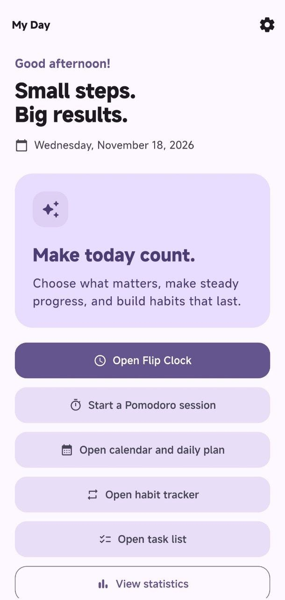
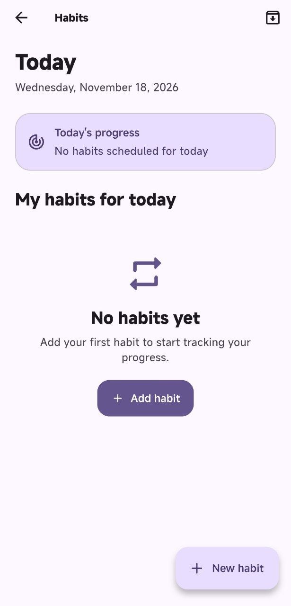
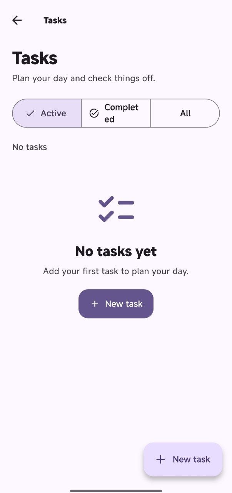
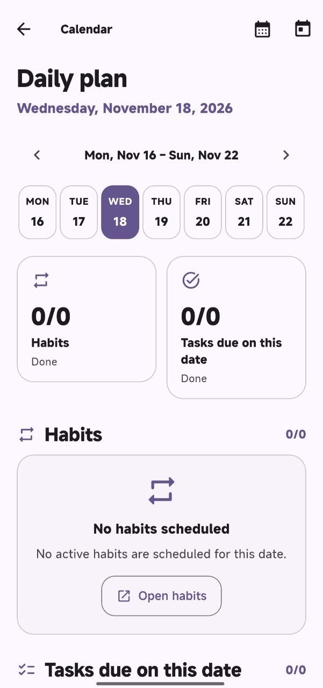
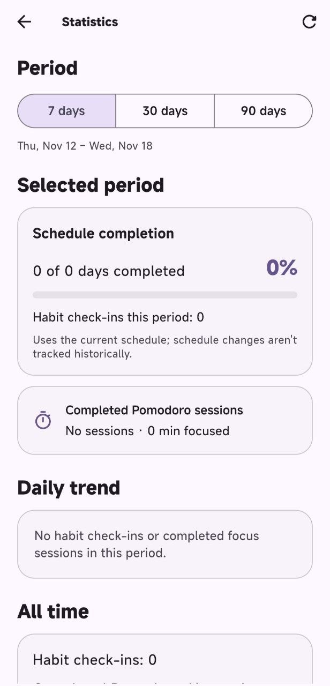
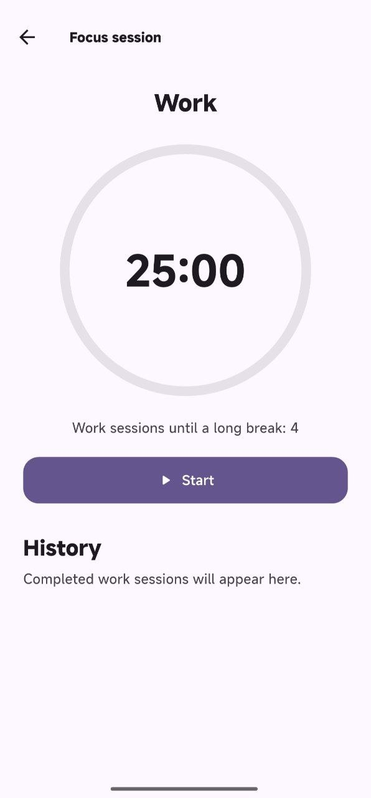
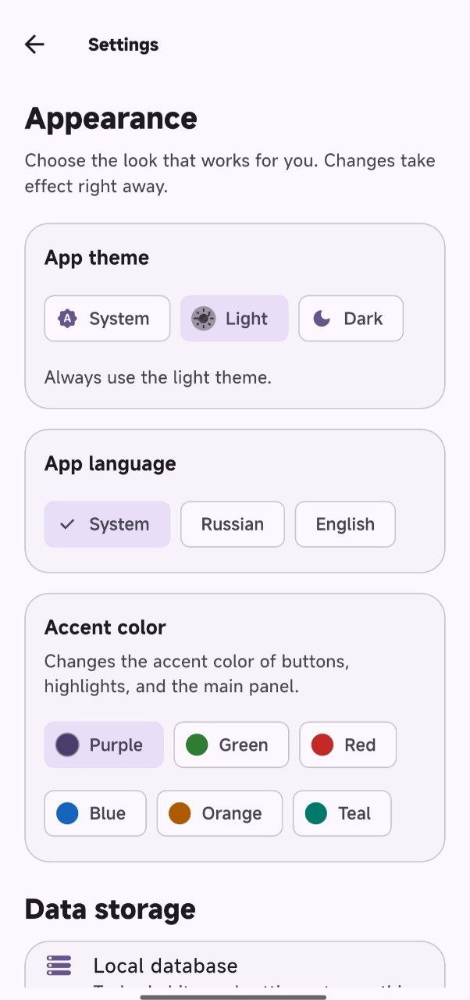

# My Day

My Day is a local-first Android productivity app built with Flutter and Material 3.

## Screenshots

| Home | Habits |
|:---:|:---:|
|  |  |

| Tasks | Calendar |
|:---:|:---:|
|  |  |

| Statistics | Focus |
|:---:|:---:|
|  |  |

| Settings |
|:---:|
|  |
## Features

- Habits with weekly schedules, tracking, archive and restoration.
- Tasks with priorities, deadlines, filters and manual ordering.
- Calendar and daily planning.
- Productivity statistics.
- Multiple clock styles and full-screen mode.
- Pomodoro focus sessions and session history.
- Trash and restoration.
- Local Android notifications.
- Android home-screen widget.
- Manual JSON export and import.
- Light and dark themes and accent colors.
- Russian and English localization.

## Privacy

- No user accounts or application backend.
- No mandatory cloud synchronization.
- Personal data is stored locally in SQLite.
- Backups are manually controlled by the user.
- Android automatic application backup is disabled.

Exported JSON backups may contain personal information. Keep them private.

## Technology

| Component | Technology |
|---|---|
| Framework | Flutter 3.47.8 |
| Language | Dart 3.13.7 |
| Interface | Material 3 |
| Database | Drift / SQLite |
| Android SDK | 36 |
| Localization | Flutter gen-l10n / ARB |
| Platform | Android |

Database schema version: **6**.
Current JSON backup format: **4**.
Supported import versions: **1, 2, 3 and 4**.

## Requirements

- Flutter 3.47.8
- Dart 3.13.7
- Android SDK 36
- Java 17 or compatible newer JDK

## Development

Clone the repository:

```bash
git clone https://github.com/lol-person/my-day.git
cd my-day
flutter pub get
flutter gen-l10n
flutter analyze
flutter test
```

Run on an Android device:

```bash
flutter run
```

## Release build

```bash
flutter build apk --release
```

For smaller architecture-specific APKs:

```bash
flutter build apk --release --split-per-abi
```
### Signing

Keep your Android release keystore and `android/key.properties` private.
Never commit signing credentials or private keys.
Back up your signing key securely. Losing it may prevent future updates signed with that key.

## Backup compatibility

Preserving JSON backup compatibility is a project requirement.
Changes to the database or backup parser must preserve existing user data,
legacy import support and transactional restoration.

## Contributing

See [CONTRIBUTING.md](CONTRIBUTING.md).

## Security

See [SECURITY.md](SECURITY.md).

## License

Distributed under the MIT License. See [LICENSE](LICENSE).
